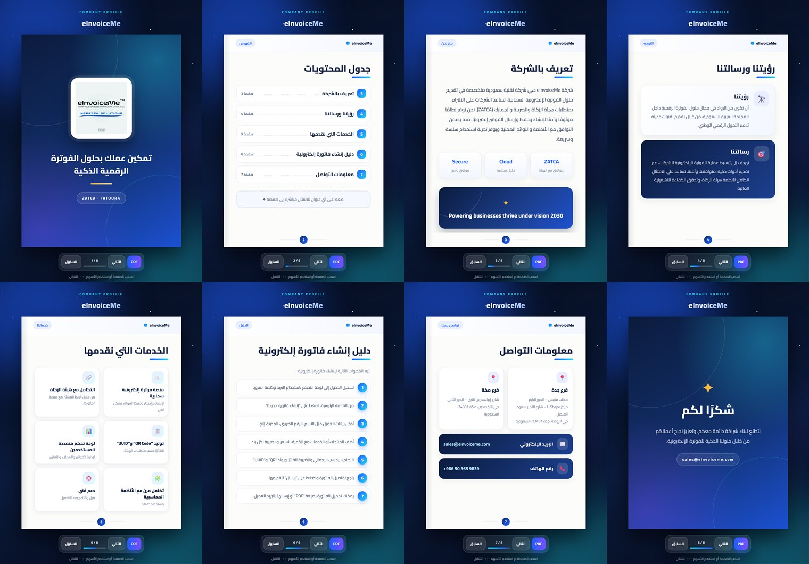
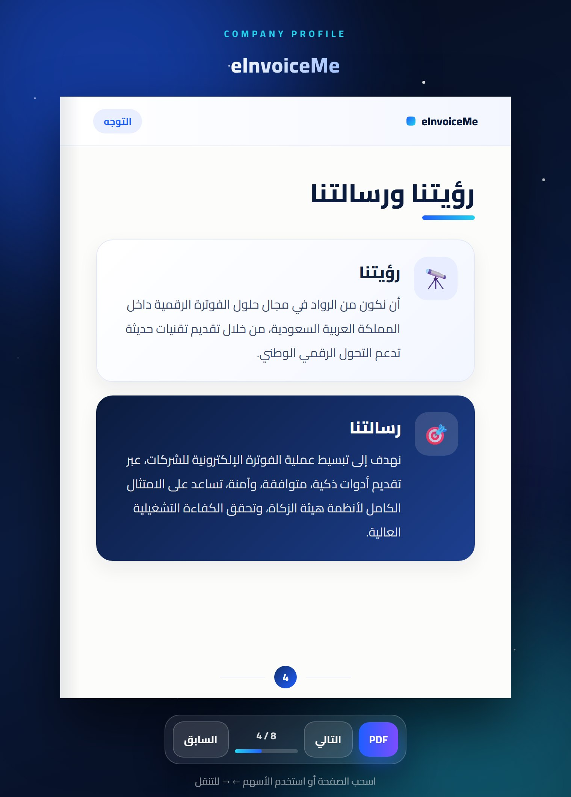
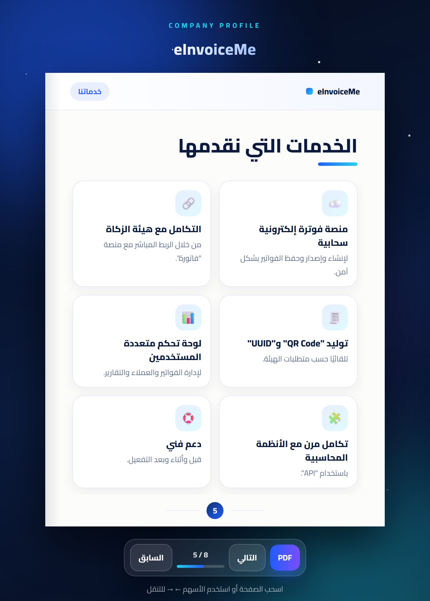
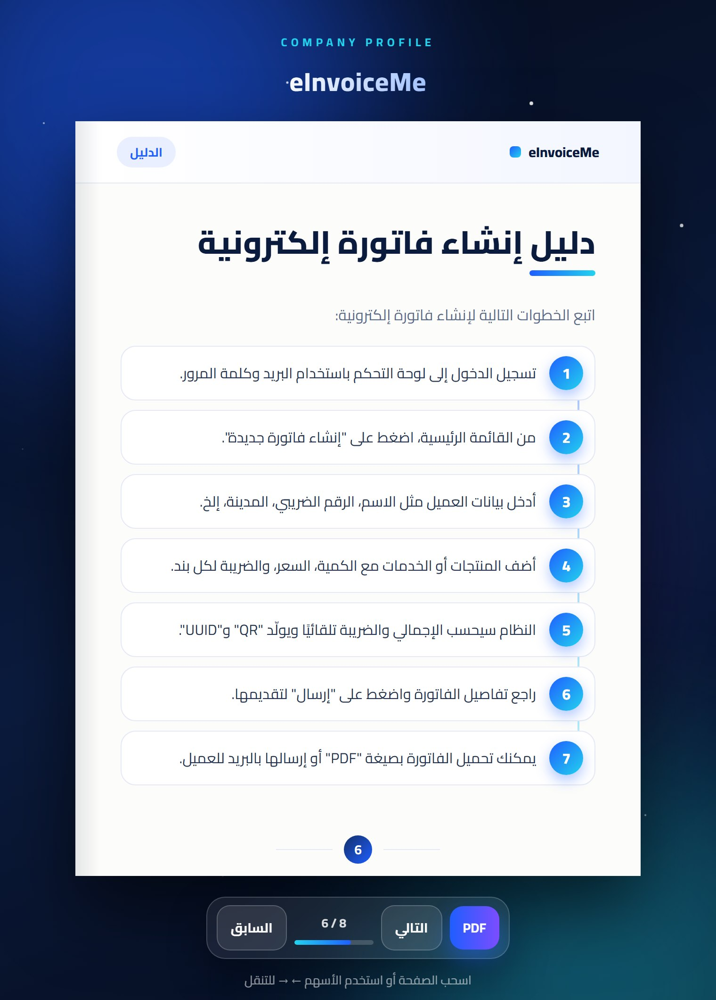
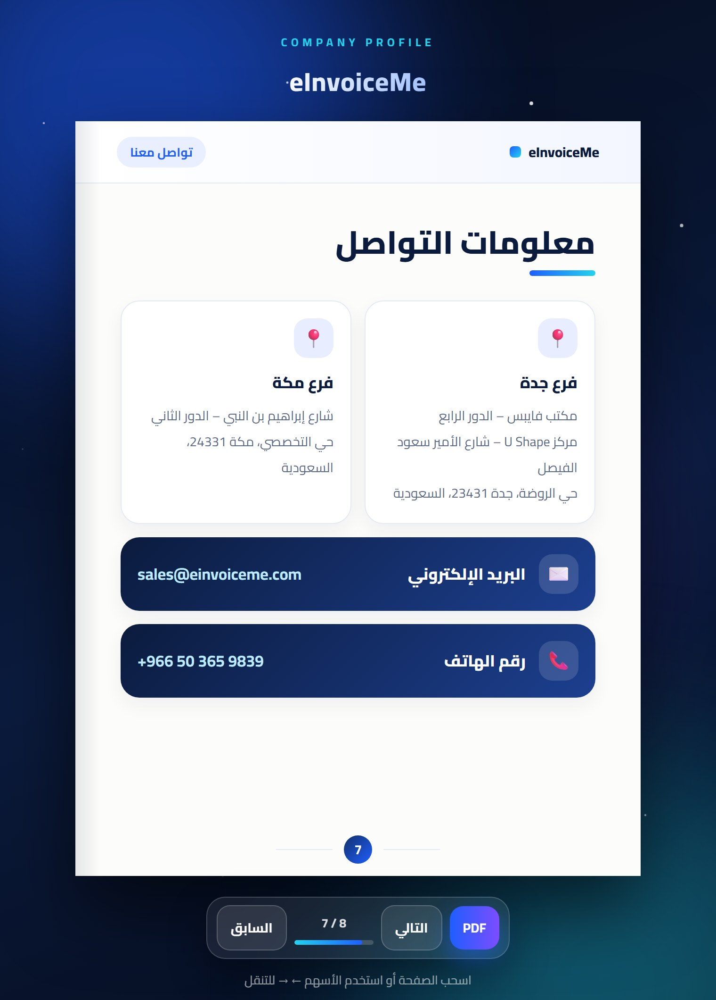
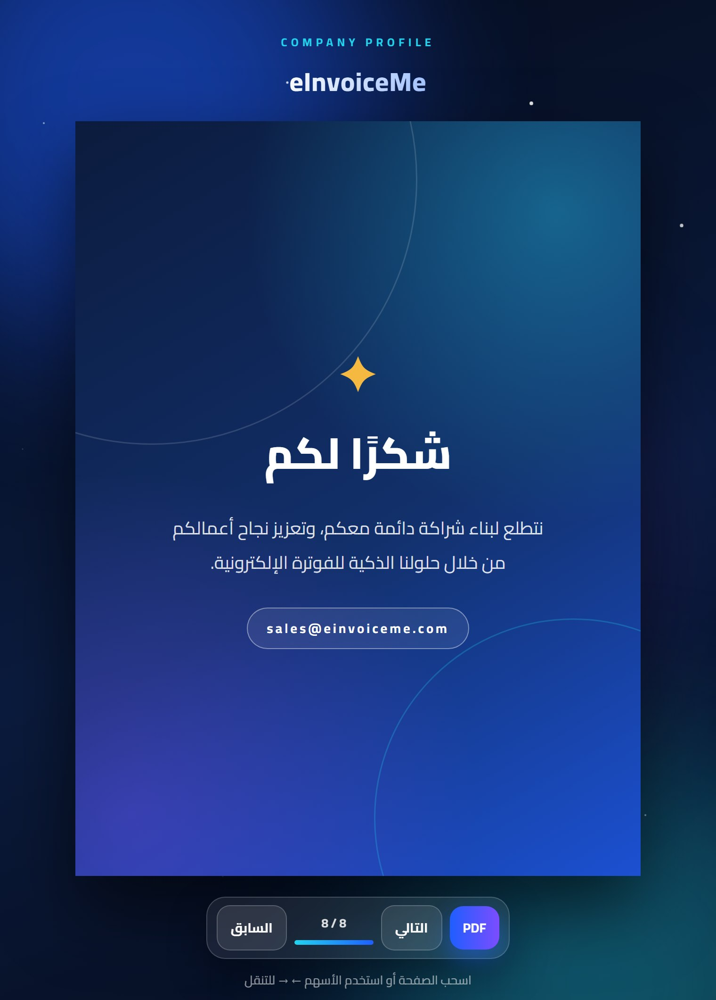

# 📖 eInvoiceMe Interactive Flipbook

A premium **interactive company profile** for **eInvoiceMe** — a Saudi e-invoicing (ZATCA / Fatoora) provider.
Readers flip through realistic book pages in the browser, jump to any section from the contents page,
and can **export the current page to PDF**. The content is in **Arabic (RTL)** and the layout adapts to any screen size.


<p align="center">
  
</p>

## Highlights

- **Premium design** – deep-navy cover with gradient rings and a logo card, paper pages with a branded header,
  section badges, gradient title accents and numbered page footers, on an animated aurora + starfield background
- **Realistic page flipping** – click, swipe, use the arrow buttons or the keyboard (← →, PageUp / PageDown)
- **Interactive contents page** – every entry is a button that jumps straight to its page
- **Glass control bar** – previous / next, live page counter with a progress bar, and a one-click **PDF** export
- **Deep links** – open a specific page with `/?page=5`
- **Responsive** – the book scales down automatically on small screens; side arrows give way to the control bar
- **Export to PDF** – captures the visible page with `html2canvas` and saves it as an A4 PDF with `jsPDF`
- **Arabic typography** – Cairo font, full RTL layout

## Screens

<table>
  <tr>
    <td width="25%"><br><sub><b>1 · Cover</b></sub></td>
    <td width="25%"><br><sub><b>2 · Contents</b></sub></td>
    <td width="25%"><br><sub><b>3 · Company overview</b></sub></td>
    <td width="25%"><br><sub><b>4 · Vision & mission</b></sub></td>
  </tr>
  <tr>
    <td><br><sub><b>5 · Services</b></sub></td>
    <td><br><sub><b>6 · Create an e-invoice</b></sub></td>
    <td><br><sub><b>7 · Contact</b></sub></td>
    <td><br><sub><b>8 · Thank you</b></sub></td>
  </tr>
</table>

| # | Page | Content |
| --- | --- | --- |
| 1 | Cover | Logo card, tagline and ZATCA · Fatoora badge |
| 2 | Contents | Clickable list of the sections |
| 3 | Company overview | Who eInvoiceMe is, with ZATCA / Cloud / Secure highlights |
| 4 | Vision & mission | Two feature cards |
| 5 | Services | Six service cards: cloud e-invoicing, ZATCA integration, QR / UUID, multi-user dashboard, accounting API, support |
| 6 | Create an e-invoice | Seven-step timeline |
| 7 | Contact | Jeddah and Makkah branches, e-mail, phone |
| 8 | Thank you | Closing page |

## Getting started

```bash
git clone https://github.com/RitalALghates/flipbook-app-react.git
cd flipbook-app-react
npm install
npm start          # http://localhost:3000
```

| Script | What it does |
| --- | --- |
| `npm start` | Development server with hot reload |
| `npm run build` | Optimised production build in `build/` |
| `npm test` | Runs the Jest + React Testing Library test suite |

Tip: the Cairo font loads from Google Fonts; offline, the app falls back to Segoe UI / Tahoma.

## Customising the content

- **Text and sections** – the page content lives at the top of [`src/App.js`](src/App.js) (`TOC`, `SERVICES`, `STEPS`)
  and in the page blocks inside `<HTMLFlipBook>`. Each page is a `div.page` that wraps a `PageChrome`
  (header, body, numbered footer). If you add or remove pages, update `TOTAL_PAGES` and the `TOC` indexes.
- **Colours and spacing** – design tokens (`--navy`, `--blue`, `--cyan`, `--gold`, …) are at the top of
  [`src/App.css`](src/App.css).
- **Logo** – replace [`public/logo.png`](public/logo.png).

## Tech stack

React 19 · Create React App · [react-pageflip](https://github.com/Nodlik/react-pageflip) ·
[jsPDF](https://github.com/parallax/jsPDF) · [html2canvas](https://html2canvas.hertzen.com/) ·
Jest + React Testing Library

## Project structure

```text
public/             index.html (Cairo font, metadata), manifest and logo assets
src/
├── App.js          Pages, navigation, deep links, scaling and PDF export
├── App.css         Design system and layouts
├── App.test.js     Smoke test
└── index.js        App entry point
docs/
├── preview.jpg     Overview of all pages
└── screenshots/    One image per page
```
