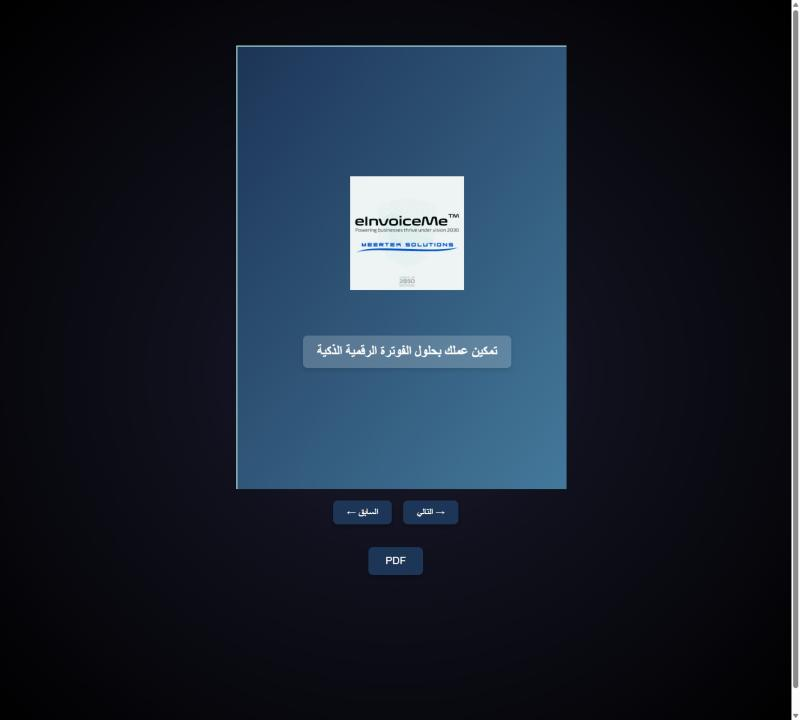
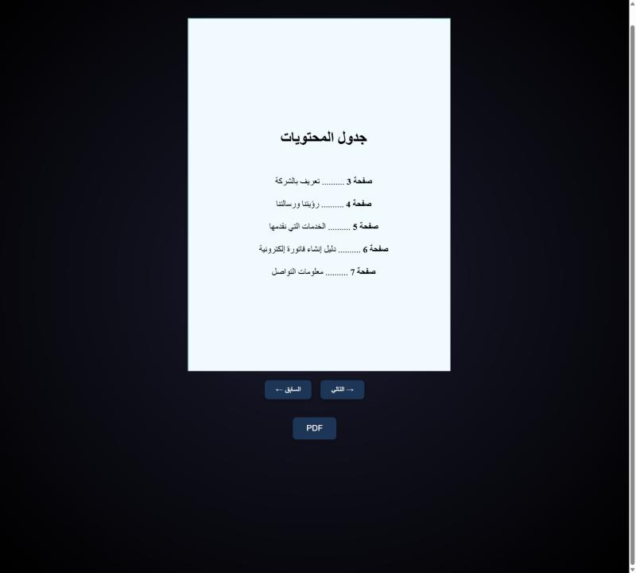
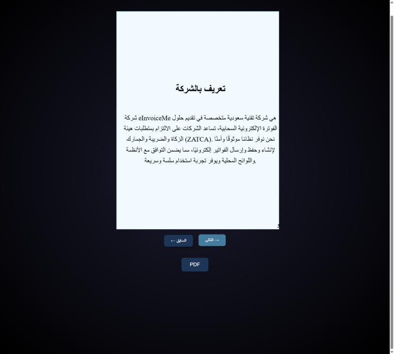
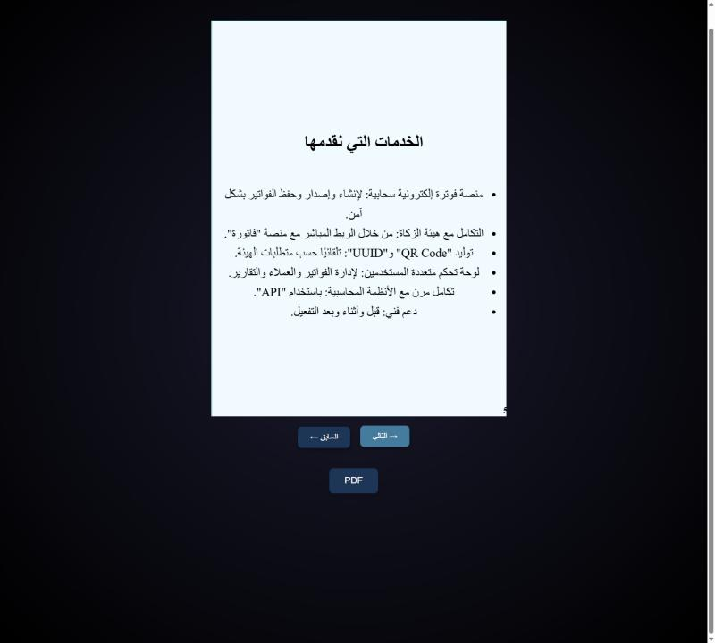

# 📖 eInvoiceMe Interactive Flipbook

An **interactive digital company profile** for **eInvoiceMe** — a Saudi e-invoicing (ZATCA / Fatoora) provider.
Readers flip through realistic book pages in the browser and can **export the current page to PDF**.
The content is in **Arabic (RTL)**.


<p align="center">
  
  
  
  
</p>

## Features

- **Realistic page flipping** (click, swipe or arrow buttons) powered by `react-pageflip`
- **Export to PDF** – captures the visible page with `html2canvas` and saves it as an A4 PDF with `jsPDF`
- **Eight designed pages:** cover · table of contents · company overview · vision & mission · services ·
  how to create an e-invoice · contact information (Jeddah and Makkah branches) · thank-you page
- Dark "space" background with animated stars and a fixed 600 × 800 book format
- Full **Arabic RTL** content

## Pages

| # | Page | Content |
| --- | --- | --- |
| 1 | Cover | eInvoiceMe logo and tagline |
| 2 | Table of contents | Links the sections to their page numbers |
| 3 | Company overview | Who eInvoiceMe is and its ZATCA compliance focus |
| 4 | Vision & mission | Where the company is heading and why |
| 5 | Services | Cloud e-invoicing, ZATCA integration, QR / UUID generation, multi-user dashboard, accounting API, support |
| 6 | Create an e-invoice | Step-by-step guide |
| 7 | Contact | Branch addresses, e-mail and phone |
| 8 | Thank you | Closing page |

## Getting started

```bash
git clone https://github.com/RitalALghates/flipbook-app-react.git
cd flipbook-app-react
npm install
npm start          # http://localhost:3000
```

| Script | What it does |
| --- | --- |
| `npm start` | Development server with hot reload |
| `npm run build` | Optimised production build in `build/` |
| `npm test` | Runs the Jest + React Testing Library test suite |

## Customising the content

All pages live in [`src/App.js`](src/App.js) as `<div className="page">` blocks inside `<HTMLFlipBook>`.
To add a page, copy an existing block (use `page page-formal content-page numbered-page` and set
`data-page-number`). Styling is in [`src/App.css`](src/App.css); the logo is [`public/logo.png`](public/logo.png).

## Tech stack

React 19 · Create React App · [react-pageflip](https://github.com/Nodlik/react-pageflip) ·
[jsPDF](https://github.com/parallax/jsPDF) · [html2canvas](https://html2canvas.hertzen.com/) ·
Jest + React Testing Library

## Project structure

```text
public/        index.html, manifest and logo assets
src/
├── App.js     Flipbook pages, navigation and PDF export
├── App.css    Layout, book and page styling
├── App.test.js  Smoke test
└── index.js   App entry point
docs/screenshots/  README images
```
